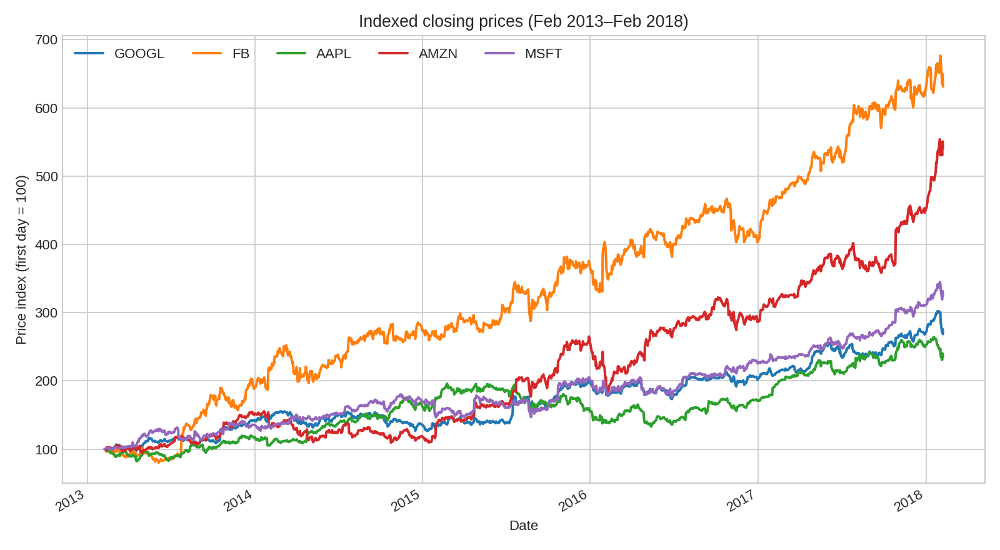
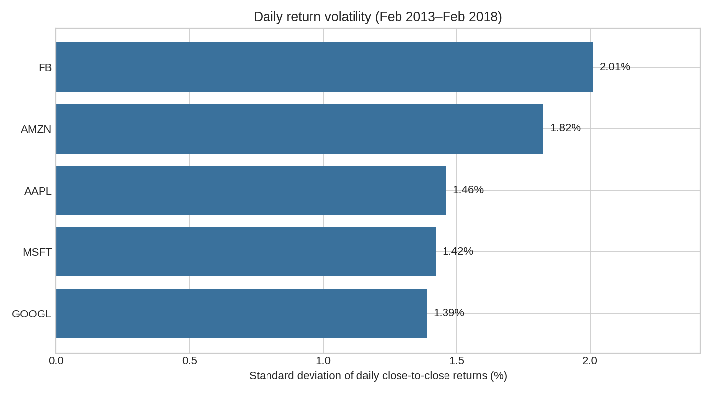

# Five Tech Companies: Historical Stock Price Comparison (2013–2018)

## Research question
How did the historical **closing-price movements** and **daily price-change volatility** of Google (GOOGL), Facebook (FB, now Meta), Apple (AAPL), Amazon (AMZN) and Microsoft (MSFT) compare between **2013-02-08 and 2018-02-07**?

## Dataset and usage permissions
The five classroom-provided CSV files each contain 1,259 dated observations with `date`, `open`, `high`, `low`, `close`, `volume`, `Name`. No missing values were found in these files. **The original public dataset source, license, and redistribution permissions have not been verified.** Before publishing the CSVs publicly, confirm the original source and applicable permissions; otherwise remove `data/` from the public repo and provide a lawful download source and instructions. The analysis uses historical educational data, not live prices.

## Methods and tools
Python, pandas, Matplotlib. Date-aligned closing-price series; an indexed price chart (each starts at 100); percentage changes of daily close prices; and sample standard deviation of daily returns as a volatility proxy.

## Results
| Ticker | First-to-last raw closing-price change | Daily change volatility |
|---|---:|---:|
| FB | 531.21% | 2.01% |
| AMZN | 440.86% | 1.82% |
| MSFT | 225.26% | 1.42% |
| GOOGL | 168.50% | 1.39% |
| AAPL | 135.12% | 1.46% |

FB shows the biggest increase in **the provided price series** and the greatest day-to-day variability. These figures are **not investor total returns**.

### Visualization 1 — normalized closing prices


### Visualization 2 — daily price-change volatility


## Limitations
**Important:** There is no confirmation that the `close` values are split-adjusted or dividend-adjusted. Differences in splits, corporate actions, and price conventions can distort cross-company comparisons. Do **not** use this chart as evidence of actual investment performance. Data end on 2018-02-07; this is a historical teaching example, not a current market study. Also, dataset origin/licensing must be verified before public redistribution.

## Reproduce the analysis
Requires Python 3.9+ and a copy of the five CSVs in `data/`.

```bash
python -m pip install -r requirements.txt
python analysis.py
```

The script writes `summary.csv`, `figures/normalized_price_trends.png`, and `figures/daily_volatility.png`. Optionally open `analysis_notebook.ipynb` in Jupyter after installing notebook support.

## Project status
Completed educational analysis, subject to dataset provenance verification.

## Origin
Adapted and expanded from the course exercise `mc648026_Activity6.01.ipynb` (user-provided), with additional indexed price comparison and volatility analysis.
